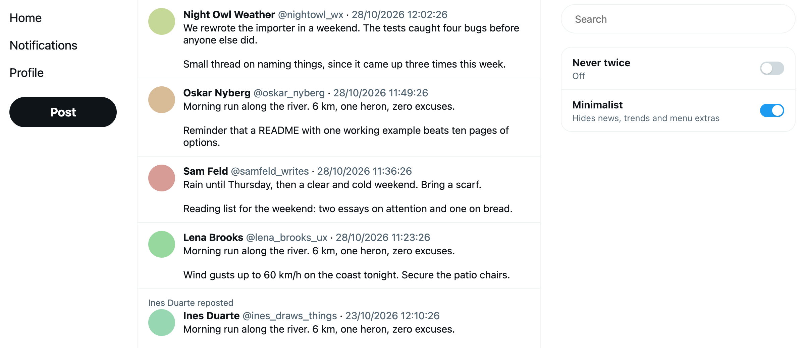
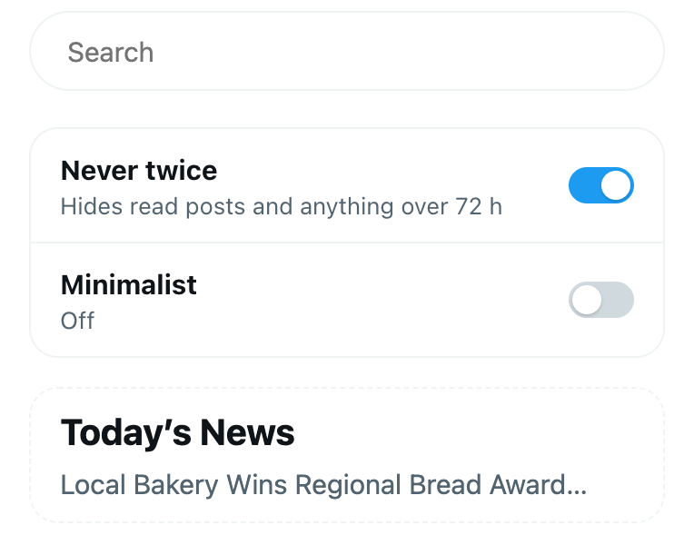
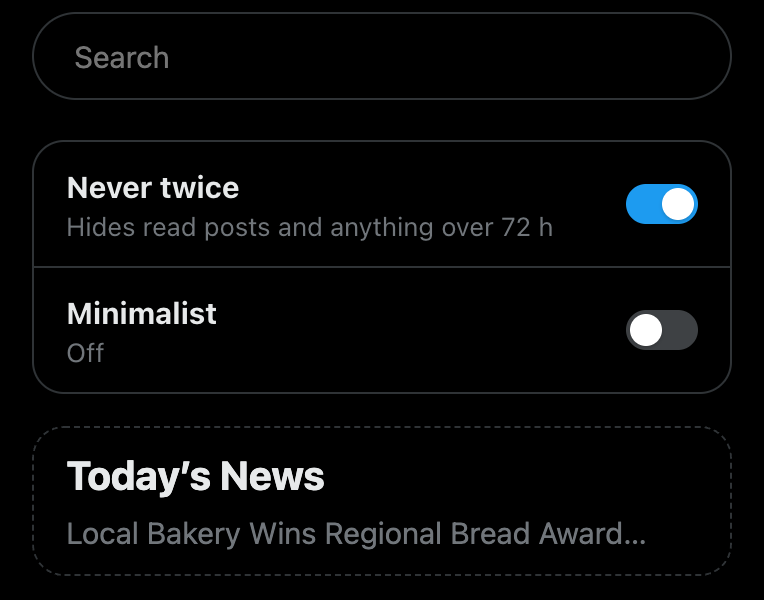

# SubFeed for X

A browser extension that adds two switches to X (Twitter) on the web.

- **Never twice** hides the posts you have already read, and anything older than 72 hours, from your Home timeline.
- **Minimalist** hides the news, trends, "who to follow" and the footer in the right column, every left-menu item except Home, Notifications, Profile and Post, and Home's tab bar, so Home always shows Following.



The switches sit at the top of X's right column, under the search bar. That's all the interface there is: no popup, no settings page, no account.

<p>
  
  
</p>

## Install

It works in any Chromium browser, version 111 or later: Chrome, Edge, Brave, Arc, Vivaldi, Opera, Helium. It is not in the Chrome Web Store, so you load it yourself. That takes about a minute.

1. Download `subfeed-for-x-<version>.zip` from the [latest release](https://github.com/Soren-Starck/subfeed-for-x/releases/latest) and unzip it.
2. Open `chrome://extensions` (in Edge, `edge://extensions`; in Brave, `brave://extensions`).
3. Turn on **Developer mode**.
4. Click **Load unpacked** and choose the unzipped `subfeed-for-x` folder.
5. Open or reload [x.com](https://x.com/home).

Keep the folder where it is: the browser runs the extension from it.

### Or from a clone, to update with `git pull`

```sh
git clone https://github.com/Soren-Starck/subfeed-for-x.git
```

Load the `extension` folder inside the clone (steps 2 to 4 above). To update, run `git pull`. The extension notices the new version the next time an X page loads, reloads itself, and the following X page load runs it.

Firefox and Safari are not supported yet. If you want to port it, see [CONTRIBUTING.md](CONTRIBUTING.md).

## Use

**Never twice** is off at first. Turn it on and X reloads your timeline with only what you haven't seen:

- A post counts as read once it has been on your screen for about a second, anywhere on X. Reposts of a post you've read are hidden too.
- Read posts are dropped from X's timeline data before X draws anything, so nothing appears and then disappears, and the page doesn't jump.
- On **Following**, the timeline ends at 72 hours. On **For you**, posts older than 72 hours are dropped wherever they appear.
- If every page is already read, the extension fetches older pages before X draws the first one, so you don't get X's empty "Welcome to X!" page. When you have read everything from the last 72 hours, X says "You're all caught up".
- The switch's subtitle counts what it hid in this tab: "Hid 54 read · 7 older than 72 h".
- Conversations stay whole while any post in them is new to you. Ads are left alone.

**Minimalist** applies at once, with no reload. With it on:

- Home has no tab bar (For you, Following, pinned lists, +) and always shows Following. If X had For you or a list open, Minimalist switches to Following before X draws a post, and X remembers that choice.
- X's logo, the account button and the **More** menu are hidden too. Turn Minimalist off to switch accounts, open a pinned list or reach Settings, or go straight to [x.com/settings](https://x.com/settings).

When the browser window is too narrow, X drops its right column, and the switches go with it. Widen the window to see them again.

## Privacy

- The extension asks for no permissions and runs only on `x.com`.
- It sends nothing anywhere. It makes no requests of its own, except to repeat X's own timeline request one page further down, to your X session, when the pages so far were all read.
- What it remembers stays in your browser, in x.com's local storage:
  - `subfeed`: the two switches, and the ids of posts you read in the last 14 days (older ones are forgotten);
  - `subfeed.log` and `subfeed.layout`: a short log of the last timeline responses and of what the switches hid, for bug reports. It holds counts and entry types, never what a post says or who wrote it.

To start over, remove those keys in DevTools (Application, Local storage, `https://x.com`).

## How it works

X's web app loads timelines with `XMLHttpRequest` and reads `responseText`. The extension runs in the page itself at `document_start` and wraps those reads for the `HomeTimeline` and `HomeLatestTimeline` GraphQL calls, removing read and old posts before X's code sees them. Minimalist is one stylesheet, keyed to X's `data-testid` attributes and links, that the extension adds to the page before X draws it, plus one click on Home's Following tab when another tab is open.

All of it is in [`extension/src/page.js`](extension/src/page.js), about 740 commented lines with no dependencies and no build step.

X changes its web app often. If it changes how timelines load, the switch's subtitle says "Not filtering: X changed how it loads posts". Please [open an issue](https://github.com/Soren-Starck/subfeed-for-x/issues/new/choose) when you see that, or when Minimalist misses something.

## Contributing

Bug reports, fixes and ports are welcome. [CONTRIBUTING.md](CONTRIBUTING.md) explains how to run the extension against a local copy of X's page and run the tests, which take about a minute.

## License

[MIT](LICENSE). SubFeed for X is an independent project, not affiliated with or endorsed by X Corp.
